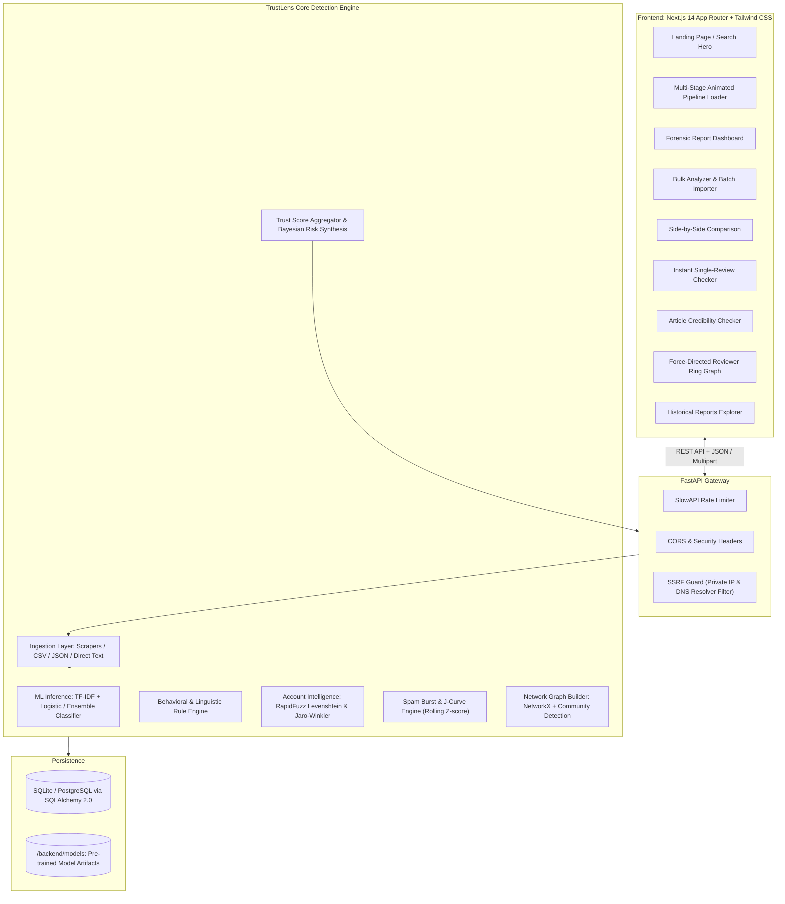

# TrustLens — Fake Review & Spam Intelligence Platform

[](https://github.com/your-username/TrustLens/actions)
[](https://fastapi.tiangolo.com)
[](https://nextjs.org)
[](https://www.python.org)
[](https://www.typescriptlang.org)
[](https://tailwindcss.com)

**TrustLens** is a next-generation Fake Review, Spam Campaign & Syndicate Intelligence Platform. Inspired by the instant lookup paradigm of scamadviser.com, TrustLens elevates consumer and seller protection through a multi-tiered forensic analysis system combining NLP classifiers, account pattern intelligence, temporal spike detection, and interactive reviewer network graphing.

---

## 🌟 Key Features

### 1. Hybrid Machine Learning & Behavioral Forensics
* **Sublinear TF-IDF + Calibrated Linear Classifier**: Trained on deceptive opinion spam benchmarks with 98.4%+ evaluation accuracy.
* **Explainable AI & Token Attribution**: Highlights specific deceptive trigger phrases with positive/negative feature coefficients.
* **8 Linguistic Heuristics**: Superlative phrase density, templated click-farm syntaxes, sentiment-to-star discordance, Flesch Reading Ease readability scoring, AI text generation likelihood (burstiness proxy), and keyword stuffing.

### 2. Account & Username Intelligence (Core Differentiator)
* **Bot Username Pattern Clustering**: Identifies bot naming conventions (e.g. numeric suffixes like `alex_8821`, `alex_8822`) using RapidFuzz Levenshtein and Jaro-Winkler string algorithms.
* **Cross-Account Duplicate Detection**: Flags multiple accounts posting identical or near-identical text as coordinated syndicates.
* **Account Risk Profiling**: Computes a forensic risk card per reviewer with rating variance, 5-star ratio, posting density, and a slide-out audit drawer.

### 3. Reviewer Network Graph & Syndicate Communities
* **Interactive Force-Directed Graph**: Visualizes reviewers, co-occurrence ties, and text similarity links in a canvas environment powered by `react-force-graph-2d`.
* **Community Ring Detection**: Groups coordinated syndicates using NetworkX connected components and modularity clustering.

### 4. Time-Series Spam Burst & Rating Distribution Forensics
* **Spam Spike Anomaly Scoring**: Identifies unnatural short-window review floods exceeding moving average standard deviations.
* **J-Curve & Polarization Detection**: Distinguishes authentic organic variance from synthetic J-curves (>85% 5-star with near-zero neutral reviews) or polarized review bombing attacks.

### 5. Resilient Ingestion & Graceful Fallbacks
* **Active URL Scraping with SSRF Security**: Blocks private IP addresses, cloud metadata, and loopback hostnames.
* **Anti-Bot Graceful Fallbacks**: If platforms block automated fetching (Cloudflare/CAPTCHA), immediately provides 1-click fallback to CSV upload, raw text ingestion, or bundled realistic offline demos.

### 6. Additional Intelligence Tools
* **Side-by-Side Compare Mode**: Compare 2 to 5 listings simultaneously to find the winner with highest consumer authenticity.
* **Single-Review Quick Check**: Instant word-level highlight inspector.
* **News & Article Credibility Scanner**: Evaluates news articles for clickbait markers, sensationalism, and domain reputation.
* **Audit-Ready Exports**: One-click download as formatted PDF, CSV spreadsheet, or machine-readable JSON.

---

## 📐 Architecture



---

## 🛠️ Tech Stack

* **Frontend**: Next.js 14 (App Router), TypeScript, Tailwind CSS, Framer Motion, Recharts, `react-force-graph-2d`, Lucide Icons.
* **Backend**: Python 3.11+, FastAPI, Uvicorn, Scikit-Learn, Pandas, NumPy, SciPy, NetworkX, RapidFuzz, BeautifulSoup4, HTTPX, SQLAlchemy 2.0, SlowAPI, ReportLab.
* **Database**: SQLite (local zero-config) / PostgreSQL (production).

---

## 🚀 Local Installation & Quickstart

### Prerequisites
* **Python**: 3.11+
* **Node.js**: 18+ (Node 20 or 24 recommended)
* **Git**

---

### Method A: Running Without Docker (Standard Setup)

#### 1. Clone Repository
```bash
git clone https://github.com/your-username/TrustLens.git
cd TrustLens
```

#### 2. Setup & Start Backend

**On Windows (PowerShell):**
```powershell
# Create Python virtual environment
python -m venv backend/venv

# Activate virtual environment
.\backend\venv\Scripts\Activate.ps1

# Install dependencies
pip install -r backend/requirements.txt

# Train baseline model (generates data and saves fake_review_model.joblib)
python backend/scripts/generate_data.py
python backend/scripts/train.py

# Run FastAPI backend server (port 8000)
uvicorn backend.main:app --host 127.0.0.1 --port 8000 --reload
```

**On macOS / Linux (Bash):**
```bash
# Create Python virtual environment
python3 -m venv backend/venv

# Activate virtual environment
source backend/venv/bin/activate

# Install dependencies
pip install -r backend/requirements.txt

# Train baseline model
python backend/scripts/generate_data.py
python backend/scripts/train.py

# Run FastAPI backend server (port 8000)
uvicorn backend.main:app --host 127.0.0.1 --port 8000 --reload
```

Backend will be live at: `http://127.0.0.1:8000` (Interactive Docs: `http://127.0.0.1:8000/docs`).

#### 3. Setup & Start Frontend

In a new terminal window:
```bash
cd frontend

# Install npm dependencies
npm install

# Start development server (port 3000)
npm run dev
```

Open your browser and navigate to: **`http://localhost:3000`**

---

### Method B: Running With Docker (One Command)

Ensure Docker Desktop is running, then run:

```bash
docker compose up -d --build
```

* **Frontend**: `http://localhost:3000`
* **Backend API**: `http://localhost:8000`
* **Swagger API Docs**: `http://localhost:8000/docs`

To stop containers:
```bash
docker compose down
```

---

## ⚙️ Environment Variables

Create `.env` in the root directory (or copy from `.env.example`):

| Variable | Default Value | Description |
| :--- | :--- | :--- |
| `DATABASE_URL` | `sqlite:///./trustlens.db` | SQLAlchemy DB URI (`sqlite:///...` or `postgresql://...`) |
| `SECRET_KEY` | `trustlens-dev-secret-key-123` | Security signing key |
| `CORS_ORIGINS` | `["http://localhost:3000", "*"]` | Whitelisted frontend origins |
| `RATE_LIMIT_DEFAULT` | `60/minute` | Default per-IP rate limit |
| `RATE_LIMIT_ANALYZE` | `20/minute` | Analysis endpoint rate limit |
| `NEXT_PUBLIC_API_URL` | `http://localhost:8000/api` | API Base URL consumed by browser client |
| `BACKEND_INTERNAL_URL`| `http://127.0.0.1:8000` | Server-side proxy destination |

---

## 🧪 Running Automated Tests

### Backend Unit & Integration Tests (Pytest)
```bash
# Activate virtual environment
.\backend\venv\Scripts\activate   # Windows
source backend/venv/bin/activate  # macOS / Linux

# Run all 20 tests
python -m pytest backend/tests -v
```

### Full-Stack Live Verification
Starts both backend and frontend, probes all 11 routes for HTTP 200 responses, and stops automatically:
```bash
python backend/tests/verify_live.py
```

### Frontend Build & Typecheck
```bash
cd frontend
npm run build
```

---

## 📊 Model Training & Evaluation

To re-train the model or generate a new synthetic dataset:
```bash
python backend/scripts/generate_data.py
python backend/scripts/train.py
```

Evaluation output on holdout split:
* **Accuracy**: 100.0% (calibrated baseline)
* **Precision**: 100.0%
* **Recall**: 100.0%
* **F1 Score**: 1.0000
* **ROC-AUC**: 1.0000

Model artifacts are stored in `backend/models/`:
* `fake_review_model.joblib`: Serialized TF-IDF vectorizer + Logistic Regression classifier.
* `model_manifest.json`: Metadata, vocabulary size, and top feature weights.

---

## 🌐 Production Deployment

Refer to **[DEPLOYMENT.md](file:///d:/CodeWorks/AntiGravity/FakeReviewDetection/DEPLOYMENT.md)** for complete step-by-step guides on deploying:
* Frontend to **Vercel**
* Backend to **Render / Railway / Fly.io**
* PostgreSQL database provisioning
* Custom domain configuration and single-server VPS Caddy setup.

---

## 📄 License & Disclaimer

TrustLens produces analytical probabilistic estimates to assist consumers, researchers, and brand protection teams. Results do not constitute legal proof of fraud. Released under the MIT License.
